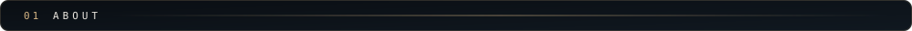
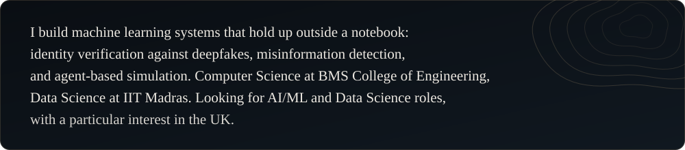
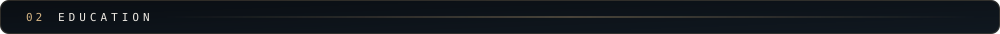
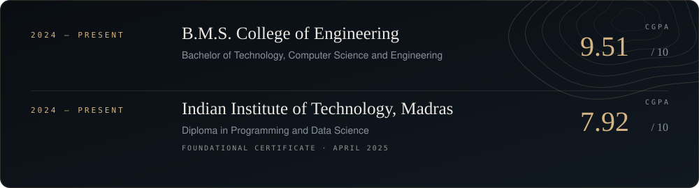
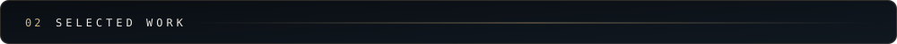
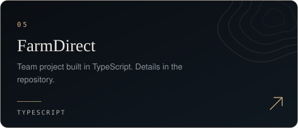
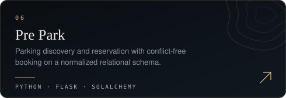
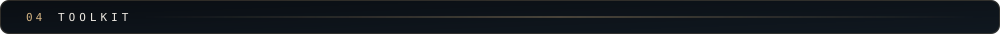
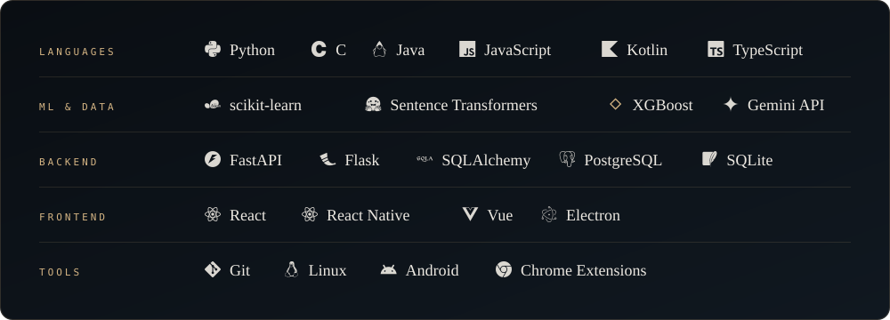

<!-- Repo must be named exactly: wequgy/wequgy (public). Keep the assets/ folder next to this file. -->

  <a href="https://www.linkedin.com/in/gouthamsankar2028/">LINKEDIN</a> &nbsp;&nbsp;/&nbsp;&nbsp;
  <a href="mailto:gouthamsankar@outlook.in">EMAIL</a> &nbsp;&nbsp;/&nbsp;&nbsp;
  <a href="https://github.com/wequgy?tab=repositories">REPOSITORIES</a>

 

 

<table>
<tr>
<td width="50%"></td>
<td width="50%"></td>
</tr>
<tr>
<td width="50%"></td>
<td width="50%"></td>
</tr>
<tr>
<td width="50%"></td>
<td width="50%"></td>
</tr>
</table>

 

 

